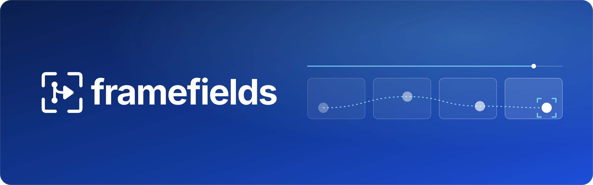
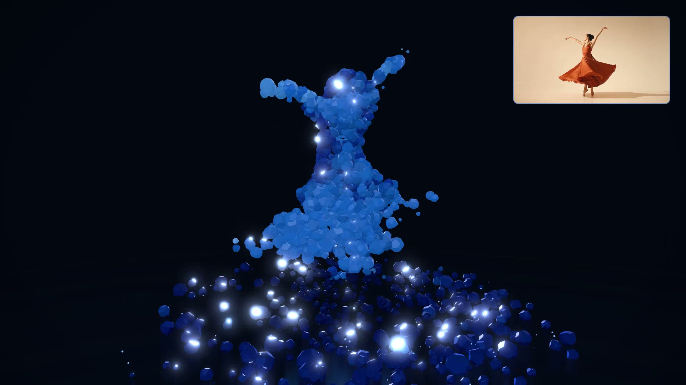
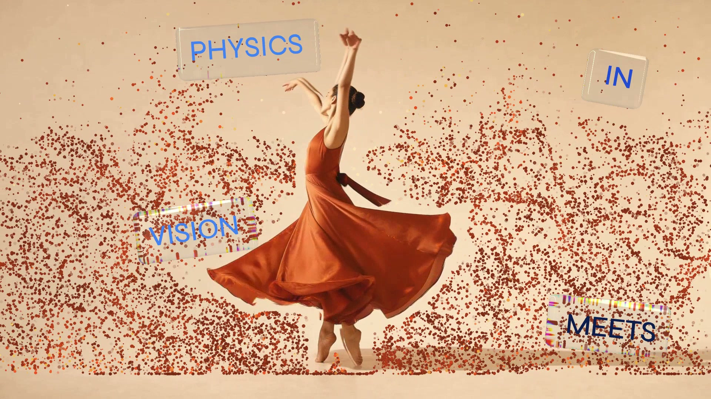
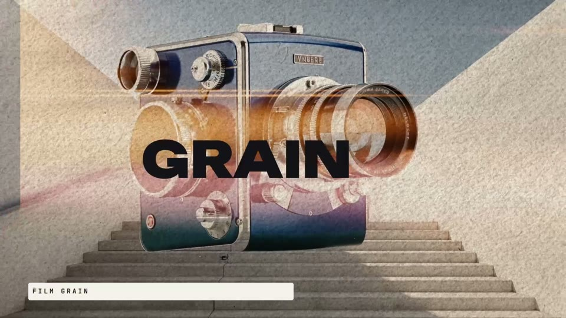
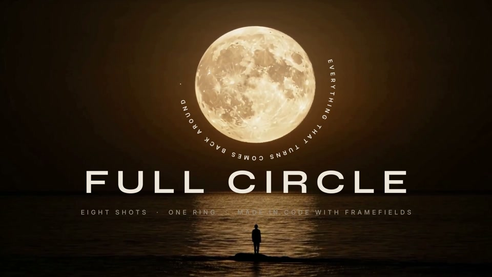

<div align="center">



### Compositing, motion graphics, and 3D for code-first video — one npm package that AI agents drive with code.

[**Documentation**](https://framefields.dev/docs) &ensp;·&ensp; [**Website**](https://framefields.dev) &ensp;·&ensp; [**Models**](https://framefields.dev/models) &ensp;·&ensp; [**Discord**](https://discord.gg/cbqMGGme5) &ensp;·&ensp; [**Examples**](examples)

[](https://www.npmjs.com/package/framefields)
[](https://framefields.dev/docs)
[](LICENCE)
[](#)
[](https://discord.gg/cbqMGGme5)
[](https://www.youtube.com/@gatewai.studio)
[](https://nodejs.org)
[](https://www.w3.org/TR/webgpu/)
[](#)

</div>

**Add to your agent**

Teach Claude Code, Cursor, Codex, Copilot, Hermes, and 70+ others how to author, animate, and render compositions:

```bash
npx skills add gatewai-dev/framefields
```

---

Framefields is built for coding agents. It packs the capabilities usually split across three desktop creative suites—Photoshop-style compositing & VFX, After Effects-style typography & motion graphics, and Blender-style 3D scenes & cameras—into a single lightweight npm package.

- **Zero Headless-Browser Overhead** — No Chromium, no Puppeteer, no DOM reflows, and no screenshot pipeline. Renders directly on native GPU hardware via Dawn / WebGPU / Metal / Vulkan.
- **Deterministic & Frame-Accurate** — Discrete sample points, absolute frame clocks, and frame-accurate audio BeatGrids. No floating timers, no drift.
- **Agent-First Workflow** — Your coding agent writes TypeScript, inspects rendered frame grids, and exports hardware-encoded MP4s headlessly.

### Made with framefields

Every frame is rendered by framefields directly from TypeScript in [`examples/`](examples). Click a still to watch on YouTube:

<table>
  <tr>
    <td width="33.33%" align="center">
      <a href="https://youtu.be/xSowU7X48J8"></a>
      <br><a href="https://youtu.be/xSowU7X48J8"><b>Shard storm</b></a>
      <br><sub><a href="examples/31_shard_storm"><code>31_shard_storm</code></a></sub>
    </td>
    <td width="33.33%" align="center">
      <a href="https://youtu.be/POC7rKnuoE4"></a>
      <br><a href="https://youtu.be/POC7rKnuoE4"><b>Physics dancer</b></a>
      <br><sub><a href="examples/28_physics_dancer"><code>28_physics_dancer</code></a></sub>
    </td>
    <td width="33.33%" align="center">
      <a href="https://youtu.be/k2lgbdL6_TA"></a>
      <br><a href="https://youtu.be/k2lgbdL6_TA"><b>Mac Keyboard</b></a>
      <br><sub><a href="examples/26_mac_keyboard_from_3d_primitives"><code>26_mac_keyboard_from_3d_primitives</code></a></sub>
    </td>
  </tr>
  <tr>
    <td width="33.33%" align="center">
      <a href="https://youtu.be/FVXTqAozAv8"></a>
      <br><a href="https://youtu.be/FVXTqAozAv8"><b>Framefields launch</b></a>
      <br><sub><a href="examples/22_framefields_launch"><code>22_framefields_launch</code></a></sub>
    </td>
    <td width="33.33%" align="center">
      <a href="https://youtu.be/9BF1snfmg3o"></a>
      <br><a href="https://youtu.be/9BF1snfmg3o"><b>Full Circle</b></a>
      <br><sub><a href="examples/21_full_circle"><code>21_full_circle</code></a></sub>
    </td>
    <td width="33.33%" align="center">
      <a href="https://youtu.be/RQ3yi_lzPqI"></a>
      <br><a href="https://youtu.be/RQ3yi_lzPqI"><b>Dancer showcase</b></a>
      <br><sub><a href="examples/19_framefields_film"><code>19_framefields_film</code></a></sub>
    </td>
  </tr>
</table>

---

## Installation

```bash
pnpm add framefields
```

Starting a new film? `framefields init` sets up the whole project: `package.json`, TypeScript, a `film.ts` to edit and a `render.ts` to render it, `assets/` with Git LFS, and the Inter, JetBrains Mono, and Noto Color Emoji fonts:

```bash
pnpm dlx framefields init my-film --install   # or: npx framefields init my-film --install
cd my-film && pnpm frames -- 0 30 60          # first frames in output/
```

Run it inside an existing project to add framefields there; it only fills in what's missing and never overwrites your files. It asks nothing, so it works in CI and on remote servers too.

> **Requirements:** Node.js ≥ 22. Native GPU acceleration via WebGPU / Dawn (macOS Metal, Linux Vulkan, Windows D3D12). Machines without a dedicated GPU can render on the CPU via Mesa lavapipe on Linux or WARP on Windows (~10–12× slower than GPU; suitable for headless CI and test frames).

---

## Quickstart

```typescript
import { Composition, Layer, LayerAnimation } from "framefields";

// 1. Create a 1080p60 composition
const comp = new Composition({
  width: 1920,
  height: 1080,
  fps: 60,
  durationFrames: 180, // 3 seconds
  backgroundColor: "#090a0f",
  fonts: ["assets/fonts/Inter.ttf", "assets/fonts/SpaceGrotesk.ttf"],
});

// 2. Physical snap-overshoot entrance animation
const entrance = LayerAnimation.create()
  .fadeIn(0, 20, "power2.out")
  .fromTo("y", 60, 0, { start: 0, end: 35, ease: "back.out(1.5)" })
  .fromTo("scale", 0.92, 1.0, { start: 0, end: 35, ease: "back.out(1.2)" });

// 3. Assemble a responsive flex-layout card with Slug vector type
const heroCard = Layer.box({
  width: 760,
  height: 380,
  background: "#141721",
  borderRadius: 24,
  borderColor: "#262b3d",
  borderWidth: 1.5,
  padding: 40,
  children: [
    Layer.flex({
      dir: "column",
      gap: 16,
      children: [
        Layer.text("FRAMEFIELDS ENGINE", {
          fontSize: 16,
          fontWeight: 700,
          fill: "#6366f1",
          letterSpacing: 2.0,
        }),
        Layer.text("Code-First Video", {
          fontSize: 48,
          fontWeight: 700,
          fill: "#f8fafc",
          fontFamily: "SpaceGrotesk",
        }),
        Layer.text("Direct GPU rendering without headless browser overhead.", {
          fontSize: 20,
          fill: "#94a3b8",
          lineHeight: 28,
        }),
      ],
    }),
  ],
}).animate(entrance);

comp.add(heroCard);

// 4. Render to hardware-encoded MP4
const { filePath } = await comp.renderVideo({
  outputPath: "output/hero.mp4",
  quality: "high",
});

console.log(`Rendered to: ${filePath}`);
process.exit(0);
```

---

## Components

Ready-made motion pieces you own: a mouse pointer with clicks and drags, a camera that zooms to them, window and device frames, word-timed captions, text reveals, counters, terminals, code blocks, title cards, lower thirds, logo reveals, backdrops, audio waveforms and more. Like a shadcn registry, `framefields add` copies a component's source into your project instead of hiding it in the package, so you can change any curve, glyph or layout.

```bash
npx framefields list                           # every component, one line each
npx framefields add mouse-pointer focus-zoom   # writes src/components/<name>/
```

```typescript
import { MousePointer } from "./components/mouse-pointer/index.js";

const pointer = MousePointer({
  path: [{ to: [400, 300] }, { to: [960, 540], click: true }],
});
comp.add(pointer);

// Every event is a cue: key a button press or a click sound to it.
const clickAt = pointer.cues.clicks[0].frame;
```

Installed components import only `framefields` and the shared toolkit in `framefields/components`, and bring along any component they build on. Files you've edited are never overwritten unless you pass `--overwrite`.

---

## Select and track a subject

Use SAM 2.1 Tiny to select a specific object with a point or box and track it through video. Its masks, bounds, motion and optional matched pose feed the existing vision signals; the same clip masks drive cutouts.

```ts
const subject = Layer.video("assets/source.mp4", {
  width: 1920, height: 1080, fit: "contain",
}).withVision({ mode: "matte" });
comp.add(subject);
const tracked = comp.vision(subject, {
  sam2: { prompts: [{ frame: 0, points: [{ x: 0.5, y: 0.5, label: 1 }] }] },
});
const target = tracked.signals.objects.get(1);
```

Prompts use normalized source coordinates. Model files download lazily, inference runs locally, and cached source-frame results support seeking and time remapping. See the [vision guide](https://framefields.dev/docs/guides/vision/#select-a-specific-object-with-sam-21-tiny) for corrections, signal tracks, model/runtime requirements and mask alignment limits.

---

## AI Gateway

Framefields provides built-in access to the [**AI Gateway**](https://framefields.dev/models), allowing agents and developers to generate cinematic video, images, music, and voiceovers directly from code using hundreds of hosted models. Explore the full model catalog in the [**AI Gateway**](https://framefields.dev/models) or read the integration guide in the [**documentation**](https://framefields.dev/docs/guides/ai/).

The gateway is optional. To use it, create a key at [**framefields.dev/dashboard**](https://framefields.dev/dashboard) and set `FRAMEFIELDS_API_KEY`. In a project made with `framefields init`, copy `.env.example` to `.env` and put the key there; `render.ts` loads it.

---

## Documentation

Everything else—including full API references, interactive tutorials, and guides—is available at [**framefields.dev/docs**](https://framefields.dev/docs):

- **[AI Gateway & Asset Generation](https://framefields.dev/models)** — Unified SDK for generating images, video clips, music, and voice via hundreds of hosted models
- **[Typography & Animators](https://framefields.dev/docs)** — Slug analytic vector text, After Effects-style range animators, and typewriter cadence
- **[WebGPU 2D VFX](https://framefields.dev/docs)** — 50+ shaders: 3D LUTs, Curves, Film Grain, Glassmorphism, and Blur
- **[Unified 3D Scenes](https://framefields.dev/docs)** — LookAt cameras, PBR materials, studio lighting, shadows, and glTF/GLB models
- **[Audio & Procedural SFX](https://framefields.dev/docs)** — BeatGrids, procedural whooshes/impacts, and audio-reactive signals
- **[On-Device Vision](https://framefields.dev/docs/guides/vision/)** — Apache-2.0 ONNX models for detection, pose, cutouts, and prompted SAM 2.1 video tracking
- **[Live Browser Preview](https://framefields.dev/docs)** — Localhost WebGPU player with scrubbing, waveform timeline, and frame-stepping

---

## Community & License

- **Documentation:** [framefields.dev/docs](https://framefields.dev/docs)
- **Website:** [framefields.dev](https://framefields.dev)
- **Discord:** [discord.gg/cbqMGGme5](https://discord.gg/cbqMGGme5)
- **YouTube:** [@gatewai.studio](https://www.youtube.com/@gatewai.studio)

Licensed under [Apache-2.0](LICENCE).
